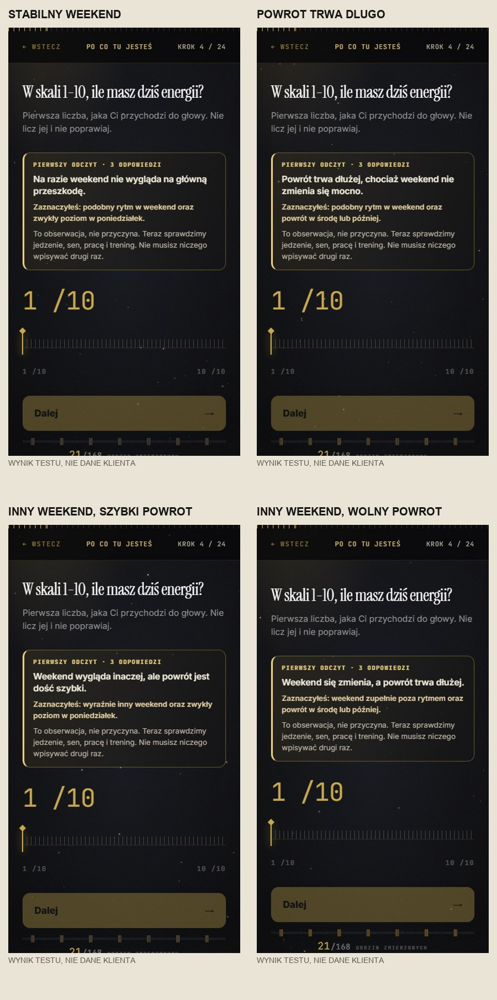
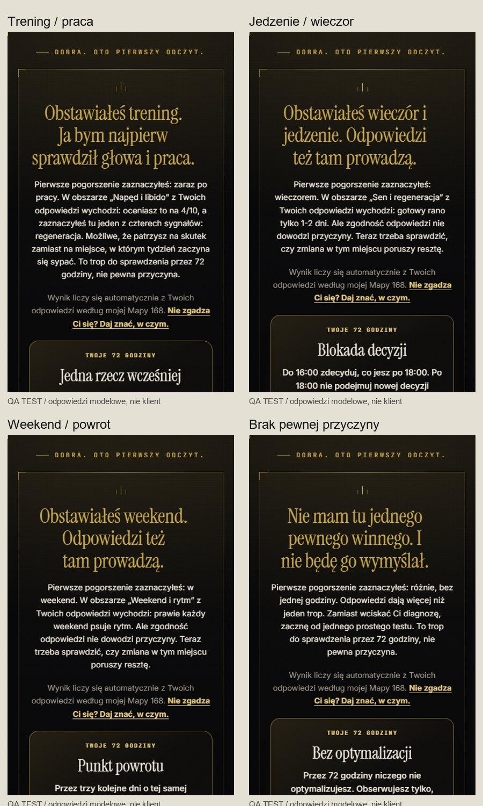
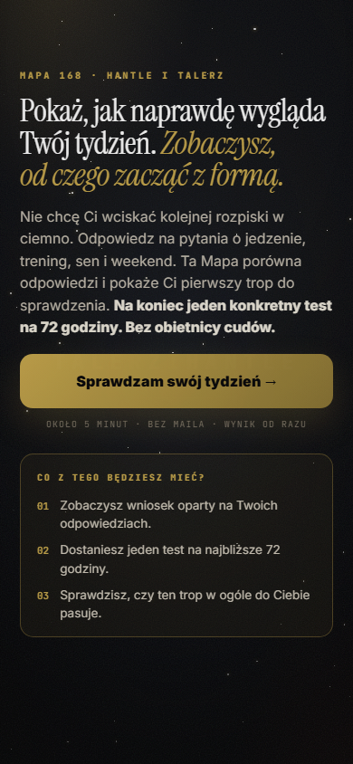

# HiT × Mapa 168 — audyt wdrożenia wejścia po follow

**08.11.2026 · baza: [produkcyjne 168.talerzihantle.com](https://168.talerzihantle.com/) · propozycja w [PR #21](https://github.com/bejster/dianostyka/pull/21)**

## Prawdziwy zakres / bez nowego produktu
- Jeden istniejący silnik wyników, jedno `assessment-config`, ten sam quiz i test 72h. Nie tworzymy drugiej diagnostyki, bazy, nowego Make czy słowa-klucza.
- Tylko osoby wchodzące po świadomym kliknięciu w DM z parametrami `door=hit`, `src=dm`, `utm_campaign=follow_welcome_168` widzą nowy hero i wcześniejszy odczyt. Standard HiT, TH2, `fast_fit` i zwykłe wejście mają niezmienione copy.
- Pierwsza wartość po 3 odpowiedziach to **obserwacja** weekendu i czasu powrotu, nie wykrycie przyczyny, wynik kliniczny ani nowy scoring. Pełny wynik dopiero po 23–24 pytaniach. Termin „około 5 minut” pochodzi z istniejącej strony.
- Kod NIE wysyła automatycznych Instagram DM. ManyChat Follow-to-DM pozostaje betą Meta, wymaga dostępności i zwykłego przycisku opt-in przed drugą wiadomością.

## Widoczne przykłady; NIE są to wyniki klientów

### Przykłady modelowe, bez fikcyjnych cytatów

| Modelowe odpowiedzi | Wczesny odczyt, tylko fakty | Pełny wynik aplikacji | 72h pierwszy ruch |
| --- | --- | --- | --- |
| Trening wypada po pracy; weekend stabilny | Na razie weekend nie wygląda na główną przeszkodę | „Obstawiałeś trening. Ja bym najpierw sprawdził głowa i praca” | „Jedna rzecz wcześniej” |
| Wieczorne jedzenie; nieco luźniejszy weekend; poniedziałkowy rozruch | Weekend na razie nie wygląda na główną przeszkodę | „Obstawiałeś wieczór i jedzenie. Odpowiedzi też tam prowadzą” | „Blokada decyzji”: zdecyduj do 16:00, co jesz po 18:00 |
| Weekend mocno inny; powrót w środę | Weekend się zmienia, a powrót trwa dłużej | „Obstawiałeś weekend. Odpowiedzi też tam prowadzą” | „Punkt powrotu”: sprawdzaj energię przez trzy dni |
| Regularne treningi, brak jasnej przyczyny; weekend stabilny | Weekend nie wygląda na główną przeszkodę | „Nie mam tu jednego pewnego winnego. I nie będę go wymyślał” | „Bez optymalizacji”: obserwuj wcześniejszy moment |

**Uczciwy red-team:** ten wczesny odczyt nie zna jeszcze realnego treningu, jedzenia i snu, więc nie może ich „diagnozować”. Nie wolno go przedstawiać jako sześciu niezależnych spersonalizowanych diagnoz po pięciu pytaniach. Długi formularz 23–24 ekranów nadal jest punktem ryzyka dla cold followerów; bez realnej analityki nie ma dowodu wyższej konwersji. Zestawy wyżej to ręcznie skonstruowane **modelowe przypadki**, nie wypowiedzi klientów.

## Testy zaakceptowane

| Test / powierzchnia | Wykonanie | Uczciwy zakres |
| --- | --- | --- |
| Niezmienione wejścia + nowy follow | 36/36 lokalny Chromium i WebKit × 390/430/1440 | Ekran otwarcia; H1/CTA, zero JS pageerror/overflow |
| Te same trasy na prawdziwym Vercel PREVIEW | 36/36 | Zewnętrzny HTTP i browser; nie produkcja |
| Pierwszy odczyt — cztery kombinacje | 8/8 na Vercel PREVIEW (Chromium/WebKit) | Widoczny po zakończeniu animacji, UI niepusty |
| Pełne ukończenie, profile trening/jedzenie/weekend/brak pewnej przyczyny | 6/6 lokalnie | 23–24 ekranów, każda próba syntetyczna; POST-y zablokowane |
| Pełne ukończenie na zewnętrznym preview | 3/3 (jedzenie/weekend/brak pewnej przyczyny) | POST-y zablokowane, bez mutacji realnego CRM |
| Nowe testy jednostkowe | 16/16 | Rozdzielenie źródeł i czterech obserwacji |
| Next.js, TypeScript, lint zakresu | PASS / PASS / 0 errors | Lint zakresu ma sześć starszych ostrzeżeń |
| Repo-wide npm test / repo-wide lint | **274/274 PASS** / **FAIL: 5 wcześniejszych błędów + 13 ostrzeżeń** | Testy źródła poprawiono: sprawdzanie TH2 toleruje opcjonalny props, układ wyniku normalizuje Windows CRLF. Repo-wide lint zawodzi poza zmienioną ścieżką (lab, /w); scoped lint 0 błędów. To nie jest ocena jakości copy |
| ManyChat → Instagram → klik → CRM → płatność | NIE TESTOWANO | Nie było uprawnionej aktywacji Follow-to-DM ani realnego klienta |

## Release gate / dalsze ograniczenia
- To **preview**, nie oznaczaj kodu w gałęzi jako LIVE przed produkcyjnym merge/release.
- Podczas testów E2E skrypty Playwright przechwytywały i odrzucały każde żądanie POST (odpowiedź 204); nie doszło do zapisu syntetycznego leada. To NIE potwierdza działającego Make/CRM.
- Należy przeprowadzić prawdziwy test na @hantleitalerz z drugim kontem tylko wtedy, gdy Meta potwierdzi dostęp do Follow-to-DM, z zabezpieczeniem JAZDA, DNC i aktywnych klientów.
- Nie obiecuj „30 sekund”, „5 pytań” ani nie sugeruj, że formularz w ogóle nie wysyła zdarzeń — istniejący backend posiada eventy.
- Źródło ManyChat: https://help.manychat.com/en/articles/17741911-follow-to-dm-on-instagram-say-hi-to-new-followers-beta (aktualizacja 29.10.2026).
- Metryki po uruchomieniu: dostarczone (faktycznie), otwarte (faktycznie), kliknięte opt-in, otwarte 168, 3 pytania, ukończony wynik, dobrowolne pytanie o pomoc, wyraźna propozycja, potwierdzona płatność. Brak liczb = brak dowodu.

## Ścieżka local QA / dowód
`C:\dev\mapa168-follow-20261108\evidence\` na autoryzowanym Talerzowniku: `follow-home-qa.json`, `preview-home-qa.json`, `preview-early-qa.json`, `follow-result-qa.json`, `preview-full-result-qa.json` i dokładne zrzuty ekranowe. Nie commitujemy prywatnych śladów i testowych logów.
